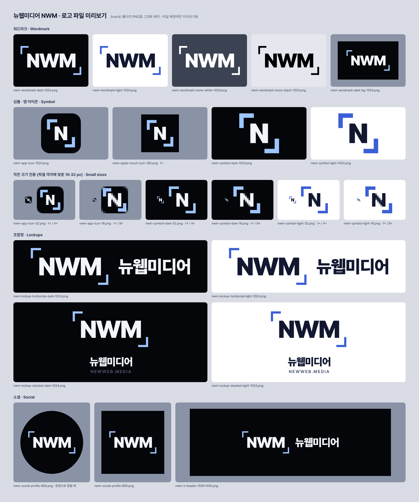

# 뉴웹미디어 로고 파일 (BI)

뉴웹미디어(NWM, newweb.media)의 로고 파일 모음입니다. 문서, SNS 프로필, 협력사 전달용으로 쓰세요.
모든 버전은 [preview.png](preview.png)에서 한눈에 볼 수 있습니다.

- 모든 SVG는 글자를 윤곽선(path)으로 바꿔 두었습니다. Pretendard 글꼴이 없는 컴퓨터에서도 똑같이 보입니다.
- PNG는 SVG에서 내보낸 것입니다. 배경이 포함된 버전을 빼면 모두 투명 배경입니다.
- 파일 이름의 `dark` / `light`는 **올려놓을 배경**을 뜻합니다.
  `dark` = 어두운 배경용(밝은 글자), `light` = 밝은 배경용(어두운 글자).

```
brand/
├─ README.md
├─ preview.png   모든 버전 미리보기
├─ wordmark/     워드마크 ⌜NWM⌟ (SVG + PNG)
├─ symbol/       심볼·앱 아이콘 (SVG + PNG)
├─ lockup/       조합형 가로·세로 (SVG + PNG)
└─ social/       SNS 프로필 사진, X 헤더 (PNG)
```



## 로고 구성

| 요소 | 모양 | 서체 |
|---|---|---|
| 워드마크 | ⌜NWM⌟ — NWM과 왼쪽 위·오른쪽 아래 모서리의 ㄱ자 브래킷 | Pretendard Black(900), 자간 −0.045em |
| 심볼 | 브래킷 안의 N (사이트 앱 아이콘) | 도형 |
| 가로형 조합 | ⌜NWM⌟ 뉴웹미디어 | 뉴웹미디어: Pretendard Black(900), 자간 −0.031em |
| 세로형 조합 | ⌜NWM⌟ / 뉴웹미디어 / NEWWEB.MEDIA | NEWWEB.MEDIA: Pretendard Bold(700), 대문자, 자간 +0.154em |

세로형 조합의 글자 크기 비율(NWM : 뉴웹미디어 : 도메인 = 150 : 64 : 26)은 사이트 공유 이미지(브랜드 카드)와 같습니다.

## 파일 목록

### wordmark/ — 워드마크 ⌜NWM⌟

| 파일 | 용도 |
|---|---|
| `nwm-wordmark-dark.svg` · `-1024.png` · `-2048.png` | 기본 버전. 어두운 배경용, 투명 배경 |
| `nwm-wordmark-light.svg` · `-1024.png` · `-2048.png` | 밝은 배경용(흰 종이, 문서), 투명 배경 |
| `nwm-wordmark-mono-white.svg` · `-1024.png` · `-2048.png` | 흰색 단색. 컬러를 쓸 수 없는 어두운 배경 |
| `nwm-wordmark-mono-black.svg` · `-1024.png` · `-2048.png` | 검정 단색. 흑백 인쇄, 팩스, 신문 지면 |
| `nwm-wordmark-dark-bg.svg` · `-1024.png` · `-2048.png` | 어두운 배경(#05060a)을 포함한 16:10 버전(1024×640, 2048×1280). 배경색을 정할 수 없는 곳(협력사 로고 목록 등) |

### symbol/ — 심볼(브래킷 N)과 앱 아이콘

| 파일 | 용도 |
|---|---|
| `nwm-app-icon.svg` · `-1024.png` · `-512.png` · `-192.png` | 앱 아이콘(어두운 둥근 사각형). 512·192는 웹 앱(PWA) 아이콘 크기 |
| `nwm-apple-touch-icon-180.png` | iPhone·iPad 홈 화면 아이콘. iOS가 모서리를 직접 둥글게 자르므로 모서리까지 채운 정사각형입니다 |
| `nwm-app-icon-32.png` · `-16.png` | 파비콘(브라우저 탭). 작은 크기 전용 디자인, 원본은 `nwm-app-icon-32px.svg` · `-16px.svg` |
| `nwm-symbol-dark.svg` · `-1024.png` · `-512.png` · `-192.png` · `-180.png` | 심볼, 어두운 배경용, 투명 배경 |
| `nwm-symbol-light.svg` · `-1024.png` · `-512.png` · `-192.png` · `-180.png` | 심볼, 밝은 배경용, 투명 배경 |
| `nwm-symbol-dark-32.png` · `-16.png`, `nwm-symbol-light-32.png` · `-16.png` | 작은 크기 전용 디자인, 원본은 같은 이름의 `-32px.svg` · `-16px.svg` |

**작은 크기 전용 디자인:** 기본 디자인을 16·32px로 줄이면 브래킷(16px에서 1.25px)과 N이 흐려집니다.
그래서 획을 픽셀 격자에 맞춰 다시 그렸습니다(16px는 브래킷 2px에 N을 키움, 32px는 획 3~4px).
32px 이하에서는 이 파일을, 그보다 크면 기본 SVG를 쓰세요.

### lockup/ — 조합형 (워드마크 + 국문 제호)

| 파일 | 용도 |
|---|---|
| `nwm-lockup-horizontal-dark.svg` · `-1024.png` · `-2048.png` | 가로형, 어두운 배경용. 웹 배너, 어두운 발표 자료 |
| `nwm-lockup-horizontal-light.svg` · `-1024.png` · `-2048.png` | 가로형, 밝은 배경용. 공문·보도자료 머리글, 협력사 로고 목록 |
| `nwm-lockup-stacked-dark.svg` · `-1024.png` · `-2048.png` | 세로형, 어두운 배경용. 정사각형에 가까운 자리, 표지, 행사 배경 |
| `nwm-lockup-stacked-light.svg` · `-1024.png` · `-2048.png` | 세로형, 밝은 배경용 |

### social/ — SNS

| 파일 | 용도 |
|---|---|
| `nwm-social-profile-800.png` | SNS 프로필 사진(800×800). 원형으로 잘려도 브래킷이 원 안에 남도록 배치 |
| `nwm-x-header-1500x500.png` | X(트위터) 헤더(1500×500). 가운데에 가로형 조합, 프로필 사진이 겹치는 왼쪽 아래는 비워 둠 |

워드마크·조합형 PNG(가로 1024px, 2048px)는 로고 바깥 여백 없이 딱 맞게 잘려 있습니다. 놓을 때 아래 여백 규정만큼 띄워 주세요.

## 색상

| 이름 | HEX | RGB | 쓰는 곳 |
|---|---|---|---|
| 딥 블랙 | `#05060a` | 5, 6, 10 | 어두운 배경, 앱 아이콘 바탕 |
| 글자 (어두운 배경용) | `#f2f5fb` | 242, 245, 251 | NWM, 뉴웹미디어, 심볼의 N |
| 아이스 블루 (어두운 배경용) | `#9ec5ff` | 158, 197, 255 | 브래킷 |
| 글자 (밝은 배경용) | `#121830` | 18, 24, 48 | NWM, 뉴웹미디어, 심볼의 N |
| 블루 (밝은 배경용) | `#3a5fd6` | 58, 95, 214 | 브래킷 |
| 도메인 | `#4f5870` | 79, 88, 112 | NEWWEB.MEDIA (세로형 조합, 두 버전 공통) |
| 태그라인 (참고) | `#a7b1c6` | 167, 177, 198 | 브랜드 카드의 태그라인. 로고 파일에는 쓰지 않음 |
| 흰색 / 검정 | `#ffffff` / `#000000` | 255, 255, 255 / 0, 0, 0 | 단색 버전 전체 |

## 여백 (클리어 스페이스)

기준 단위는 **a = 브래킷 한쪽 팔의 길이**입니다(워드마크 높이의 28%).

- 워드마크와 조합형 둘레에 **최소 1a**를 비워 두세요. 이 안에 다른 글자, 이미지, 종이 가장자리가 들어오면 안 됩니다.
- 조합형 안의 간격(워드마크와 국문 제호 사이)도 1a입니다.
- 심볼은 심볼의 브래킷 팔 길이(심볼 높이의 약 37%)만큼, 앱 아이콘은 아이콘 폭의 1/4 이상 비웁니다.
- PNG 기준 1a: 워드마크 1024px → 135px, 가로형 1024px → 66px, 세로형 1024px → 135px (2048px 파일은 두 배).

## 최소 크기

| 버전 | 화면 | 인쇄 |
|---|---|---|
| 워드마크 | 가로 64px | 가로 15mm |
| 가로형 조합 | 가로 140px | 가로 30mm |
| 세로형 조합 | 가로 240px | 가로 40mm |
| 심볼·앱 아이콘 | 16px (32px 이하는 작은 크기 전용 파일) | 6mm |

이보다 작으면 브래킷이 흐려지거나 NEWWEB.MEDIA를 읽기 어렵습니다. 더 작은 자리에는 워드마크나 심볼을 쓰세요.

## 하지 말 것

1. **늘리거나 찌그러뜨리지 마세요.** 크기를 바꿀 때는 가로세로 비율을 고정하세요.
2. **색을 바꾸지 마세요.** 위 표의 조합(어두운 배경용, 밝은 배경용, 흰색·검정 단색)만 씁니다. 브래킷이나 글자 한쪽만 다른 색으로 바꾸는 것도 안 됩니다.
3. **효과를 더하지 마세요.** 그림자, 외곽선, 글로우, 그라데이션, 입체 효과 모두 쓰지 않습니다.
4. **복잡한 배경 위에 바로 올리지 마세요.** 사진이나 패턴 위에는 단색 면을 깔거나 `nwm-wordmark-dark-bg`를 쓰세요.

## 참고

- 사이트의 로고(`src/components/ui/Wordmark.tsx`의 lg 크기: 글자 34px, 안쪽 여백 세로 8px·가로 10px, 브래킷 팔 14px, 굵기 3px)와 앱 아이콘(`src/app/icon.svg`)을 비율 그대로 키운 것입니다.
- 브래킷 상자 크기는 사이트에서 브라우저가 그리는 것과 같습니다. 브라우저는 마지막 글자 M 뒤에도 자간(−0.045em)을 적용하므로, M 오른쪽 안쪽 여백이 N 왼쪽보다 0.045em 좁습니다. 사이트와 같게 맞춘 것이니 고치지 마세요.
- 윤곽선은 Pretendard 글꼴 파일(OTF)에서 그대로 뽑았고, 브라우저가 같은 글꼴로 그린 글자와 겹쳐 비교해 일치함을 확인했습니다(글자 크기 340px에서 평균 0.002px 차이).
- 로고와 함께 쓸 글꼴이 필요하면 Pretendard를 쓰세요(SIL Open Font License 1.1, 무료).
